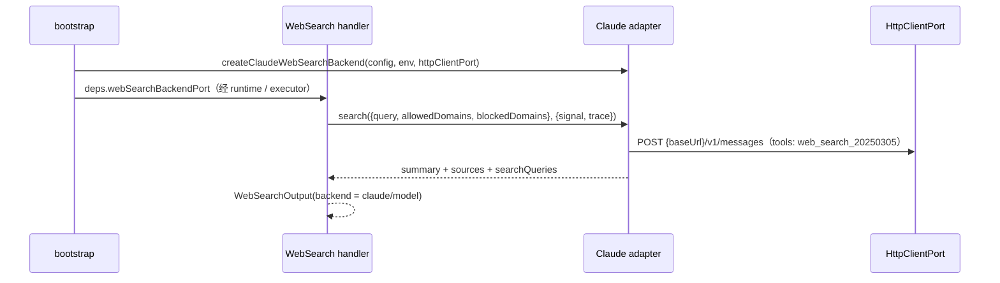

# WebSearch 的 Claude Haiku 搜索后端

## 背景

`WebSearch` 已有可替换后端机制（`WebSearchBackendPort`，见 `web-search-gemini.md`）。本次增加第二个
后端：用 Claude Haiku 通过 Anthropic Messages API 的服务端 `web_search` 工具执行搜索，与当前
Active Model 无关。适用于主模型不支持原生搜索（如第三方兼容模型），但用户持有 Anthropic Key、希望
用便宜快速的 Haiku 做搜索的场景。

## 产品规则

- 只在用户配置 `webSearch.provider = "claude"` 时启用；默认仍为 `"native"`。不因环境里恰好存在
  `ANTHROPIC_API_KEY` 就自动切换。
- 启用后与 Gemini 相同：**后端优先**，所有 `WebSearch` 调用走 Claude，`WebSearch` 对所有模型暴露
  （主会话、子代理、workflow 子会话一致）。路由事实仍只有一个：`WebSearchBackendPort` 是否在场。
- `provider` 同一时刻只能选一个后端，不做 Gemini → Claude 的自动回退链。
- 默认模型 `claude-haiku-4-5`，默认端点 `https://api.anthropic.com`。仅支持 API Key（`x-api-key`）。

## 配置

```json
{
  "webSearch": {
    "provider": "claude",
    "claude": {
      "apiKey": "<your-anthropic-api-key>",
      "model": "claude-haiku-4-5",
      "baseUrl": "https://api.anthropic.com"
    }
  }
}
```

| 字段 | 默认 | 说明 |
|---|---|---|
| `webSearch.provider` | `"native"` | 新增取值 `"claude"` |
| `webSearch.claude.apiKey` | 无 | 缺省时读取 `ANTHROPIC_API_KEY` |
| `webSearch.claude.model` | `claude-haiku-4-5` | 任意支持 `web_search` 服务端工具的 Claude 模型 id |
| `webSearch.claude.baseUrl` | `https://api.anthropic.com` | http(s) 绝对地址，请求路径为 `{baseUrl}/v1/messages`；可指向兼容网关 |

- API Key 优先级：配置文件 `apiKey` > `ANTHROPIC_API_KEY`；环境变量只在 adapter 层读取。
  不读取 `ANTHROPIC_BASE_URL`：搜索端点只由 `webSearch.claude.baseUrl` 决定，避免其他工具的环境变量
  改变本功能的数据流向。
- `webSearch` 仍只接受 User / Env / CLI 层，Project 层丢弃（同 Gemini，防止仓库重定向 baseUrl 窃取 Key）。
- 网络代理、自定义 CA、超时沿用 `network.*`（复用同一 `HttpClientPort`）。

## 所有者与接口

- 配置事实：`RuntimeConfig.webSearch.claude`（contracts），adapters 配置加载器解析与合并。
- 后端能力：`WebSearchBackendPort`，`provider` 扩为 `"gemini" | "claude"`。bootstrap 按
  `webSearch.provider` 选择构造哪一个实现；core 不读配置、不感知具体后端。
- 输出 `backend.provider` 取值同步扩为 `"gemini" | "claude"`。



## 请求与结果

- 请求：`POST {baseUrl}/v1/messages`，头 `x-api-key`、`anthropic-version: 2023-06-01`，非流式。
  `max_tokens = 4096`，一段 system 要求基于搜索结果回答并给出来源，user 消息为查询词。
  `tools: [{ type: "web_search_20250305", name: "web_search", max_uses: 5, allowed_domains | blocked_domains }]`。
- 域名过滤：Anthropic 原生支持 `allowed_domains` / `blocked_domains`（二者互斥，输入层已校验），
  直接透传，不拼 `site:` 运算符。域名只做 trim 与去 scheme/路径的归一化。
- `maxUses`：后端固定 5；用户传入的 `maxUses` 不影响后端（与 Gemini 一致，由后端决定）。
- 结果：
  - `summary`：`content` 中所有 `text` 块按序拼接。
  - `sources`：`web_search_tool_result.content[]` 里的 `web_search_result`（`url`/`title`）与文本块
    `citations[].url/title` 合并，按 URL 去重。
  - `searchQueries`：`server_tool_use`（name = `web_search`）的 `input.query`；
    `webSearchRequests` 取 `searchQueries.length`。
  - `model`：响应的 `model` 字段，缺省为配置的模型 id。
- 不回填 `modelUsage`：Haiku 的 token 不属于会话模型，写进会话用量会污染上下文与计费统计。

## 失败语义

| 场景 | 行为 |
|---|---|
| `provider = "claude"` 但无 API Key | 端口仍构造、`WebSearch` 仍暴露；调用时抛 `configuration_error`（recoverable），提示配置项与环境变量名 |
| `baseUrl` 非法 | 同上，调用时抛 `configuration_error` |
| HTTP 429 / 500 / 502 / 503 / 504 / 529 | 最多重试 2 次，退避 1s、2s；取消信号立即终止 |
| 其他非 2xx | 抛 `model_error`，带状态码与脱敏响应片段（截断 500 字符，Key 替换为 `[redacted]`）；429 用 `model_rate_limited` |
| 响应含 `web_search_tool_result_error` 且无文本、无来源 | 抛 `model_error`，带 `error_code`（如 `max_uses_exceeded`、`too_many_requests`、`unavailable`） |
| 响应无文本且无来源 | 抛 `model_error`（empty search response） |
| 取消 / 超时 | 由 `HttpClientPort` 的 `cancelled` / `timeout` 向上冒泡 |

## 验收场景

1. 未配置 `webSearch`：行为不变。
2. `provider: "claude"` + Key：任意模型都暴露 `WebSearch`，请求发往 `{baseUrl}/v1/messages`，
   结果含 summary、去重来源、`backend.provider = "claude"`。
3. `provider: "claude"` 无 Key：调用返回可读的配置错误。
4. 工作区配置中的 `webSearch` 不生效。
5. `allowed_domains` / `blocked_domains` 原样进入 `web_search` 工具参数。
6. `provider: "gemini"` 行为不受影响。
